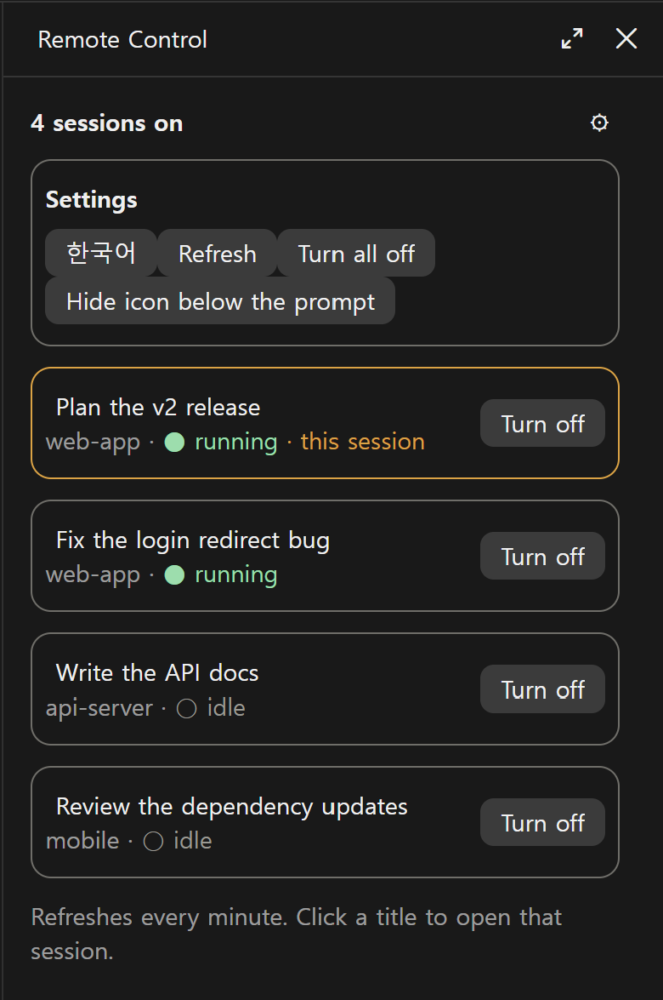
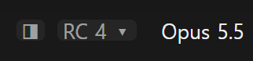

# RC Panel

[English](README.md)

Claude 데스크톱 앱에서 Remote Control이 켜진 세션을 한눈에 보여 주고, 그 세션으로 바로 이동시켜 끌 수 있게 하는 옆 패널입니다. Remote Control은 세션마다 따로 켜기 때문에, 어느 세션이 아직 폰이나 claude.ai에서 열려 있는지 놓치기 쉽습니다. RC Panel은 그 세션들을 목록 하나로 모읍니다.

Claude Code mod라서 데스크톱 앱 안에서 돌아가고, 서버·계정·API 키가 필요 없습니다.



*스크린샷은 `/rc-panel demo`의 예시 데이터입니다.*

## 기능

- **목록 하나:** 이 컴퓨터에서 Remote Control이 켜진 세션을 모두 보여 줍니다. 지금 세션이 맨 위에 옵니다.
- **상태:** 카드마다 폴더, 실행 중(●)인지 쉬는 중(○)인지, 지금 세션인지가 표시됩니다.
- **이동:** 카드마다 있는 **이동** 버튼(또는 제목)을 누르면 앱에서 그 세션이 열립니다. 끄기는 그 세션의 툴바에서 합니다. 패널이 직접 끄지 않는 이유는 한계에 적었습니다.
- **간편 여닫기:** 입력창 아래의 흐린 `RC` 버튼이 패널을 열고 닫으며, 켜진 세션 수(`RC 5`)를 보여 줍니다. `/rc-panel`도 같은 일을 합니다. 버튼은 설정에서 숨길 수 있습니다.
- **한국어와 영어:** 고른 언어를 기억합니다.

목록은 1분마다 스스로 새로 고칩니다.

실제 세션을 건드리지 않고 써 보려면 `/rc-panel demo`를 입력합니다. 예시 세션을 보여 주고, 버튼을 눌러도 앱에서 바뀌는 것이 없습니다.

## 설치

Claude 데스크톱 앱과 Claude Code CLI가 필요합니다. 터미널 세션의 입력창에서 실행합니다.

```
/plugin install rc-panel --marketplace dshw1234-dot/rc-panel
```

마켓플레이스를 추가할지 물으면 `y`, 범위는 user를 고릅니다. 셸에서는 다음을 실행합니다.

```bash
claude plugin install rc-panel --marketplace dshw1234-dot/rc-panel
```

`/plugin`이 동작하지 않는 데스크톱 앱에서는 입력창 옆 + → Plugins → Add marketplace에 `dshw1234-dot/rc-panel`을 넣고 Add plugin을 누릅니다.

새 세션을 열고 입력창 아래 `RC`를 누르거나 `/rc-panel`을 입력합니다.



패널 오른쪽 위 ⚙ 버튼을 누르면 설정(언어, 새로 고침, 입력창 아래 아이콘 숨기기)이 열립니다.

## 읽는 것과 보내는 것

- **스스로 부르는 도구.** 데스크톱 앱의 세션 도구 두 개만 부르고, 다른 도구는 부르지 않습니다.
  - `mcp__ccd_session_mgmt__list_sessions`와 `mcp__ccd_session_mgmt__get_session`(`self`): Remote Control이 켜진 세션을 읽습니다. 세션이 시작될 때, 1분마다, 패널을 열 때, **새로 고침**을 누를 때 부릅니다. 1분마다 하는 새로 고침은 먼저 권한 확인을 하고, 이미 허용된 도구가 아니면 부르지 않아서 권한 창을 띄우지 않습니다. `/rc-panel demo`에서는 하나도 부르지 않습니다.
- **실행하는 프로그램 하나.** **이동**이나 세션 제목을 누르면 링크 `claude://claude.ai/epitaxy/<세션 id>`를 열어 데스크톱 앱이 그 세션을 보여 주게 합니다. Windows(환경 변수 `OS`가 `Windows_NT`)에서는 `rundll32 url.dll,FileProtocolHandler <링크>`로, 그 밖(macOS)에서는 `open <링크>`로 엽니다. 세션 id가 `local_` 뒤에 영문·숫자·하이픈만 오는 모양이 아니면 아무것도 실행하지 않습니다.
- **보내는 것.** 컴퓨터 밖으로 보내는 것이 없습니다. 네트워크 요청을 하지 않고 모델도 부르지 않으므로 토큰을 쓰지 않습니다. 읽은 내용(세션 제목, 폴더, 실행 상태)은 패널에만 보입니다.
- **훅.** `ui.close`는 자기 패널이 닫혔는지 알아채는 데만 쓰고, 이벤트는 그대로 넘깁니다. 명령 `/rc-panel` 하나를 더하고, 입력창 아래 상태 줄에 버튼 하나를 그립니다. 다른 mod가 그 자리에 그린 것은 그대로 둡니다.

## 한계

- **Claude 데스크톱 앱 전용.** 쓰는 세션 도구가 데스크톱 앱에만 있어서, 일반 터미널에서는 목록이 비어 있습니다.
- **끄기 버튼이 없습니다.** 0.1.6까지는 패널이 직접 껐습니다. 그런데 데스크톱 앱(4.4212)에서는 세션이 쉬는 동안 버튼으로 이 도구를 부르면 턴 밖에서 승인 요청이 생기고, 그 세션에 '작업 중' 시간 표시가 메시지를 보낼 때까지 멈추지 않았습니다. 설정 훅과 허용 규칙으로도 그 승인 요청을 막지 못해서, 지금은 그 세션으로 이동만 시킵니다.
- **Windows와 macOS.** 데스크톱 앱이 이 둘에서 돌아갑니다. 시험은 Windows에서만 했고(Claude Code 2.1.314), macOS 지원은 코드만 넣고 시험하지 않았습니다.

## 함께 쓰면 좋은 mod

- [Session Tree](https://github.com/dshw1234-dot/session-tree): 데스크톱 세션을 폴더별 가계도로 그리는 옆 패널입니다. 입력창 아래에서 ◨ 버튼이 `RC` 옆에 놓입니다.

## 라이선스

MIT
