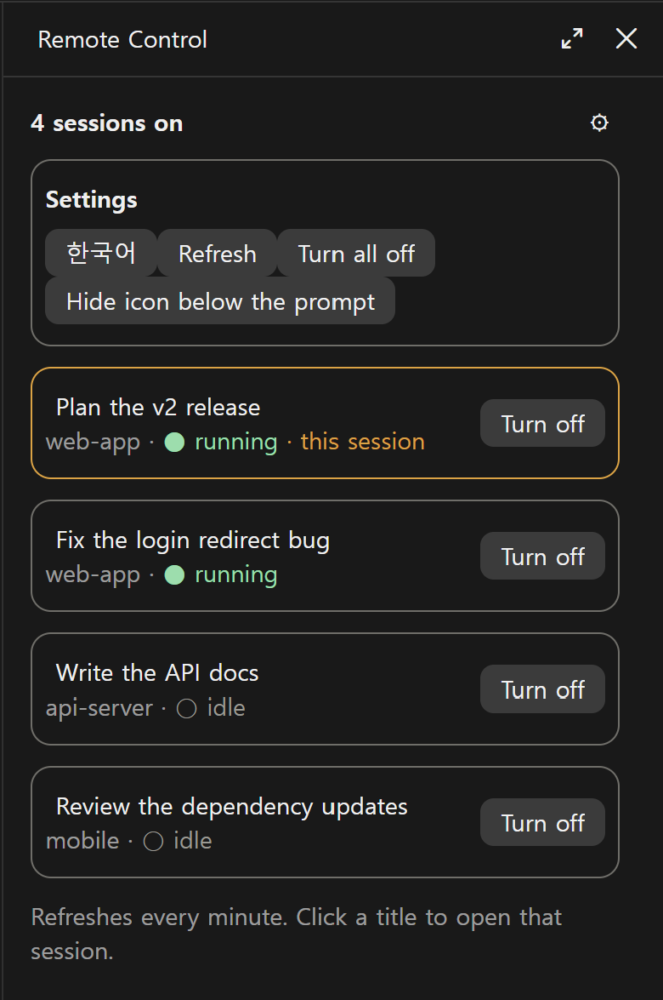
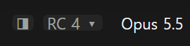

# RC Panel

[한국어](README.ko.md)

A side panel for the Claude desktop app that shows which of your sessions have Remote Control on and takes you to each one, so you can turn it off there. Remote Control is switched on session by session, so it is easy to lose track of which sessions are still reachable from your phone or claude.ai. RC Panel puts them in one list.

It is a Claude Code mod: it runs inside the desktop app and needs no server, account or API key.



*The screenshot uses the sample data from `/rc-panel demo`.*

## Features

- **One list:** every session on this computer with Remote Control on, this session first.
- **Status:** each card shows the folder, whether the session is running (●) or idle (○), and marks the current session.
- **Open:** an **Open** button on each card (and the title) opens that session in the app, where you turn Remote Control off from its toolbar. The panel does not turn it off for you: see Limitations.
- **Quick toggle:** a dim `RC` button below the prompt opens and closes the panel and shows how many sessions are on (`RC 5`). `/rc-panel` does the same. The button can be hidden in the settings.
- **Korean and English:** the language you pick is remembered.

The list refreshes itself every minute.

To try it without touching your real sessions, type `/rc-panel demo`. It shows sample sessions, and its buttons change nothing in the app.

## Install

Needs the Claude desktop app and the Claude Code CLI. At the prompt of a terminal session:

```
/plugin install rc-panel --marketplace dshw1234-dot/rc-panel
```

Answer `y` to add the marketplace, then pick the user scope. From a shell:

```bash
claude plugin install rc-panel --marketplace dshw1234-dot/rc-panel
```

In the desktop app, where `/plugin` does not run: click + next to the prompt box, then Plugins, Add marketplace with `dshw1234-dot/rc-panel`, then Add plugin.

Open a new session, and click `RC` below the prompt or type `/rc-panel`.



The ⚙ button at the top right of the panel opens the settings: language, refresh, and hide the icon below the prompt.

## What it reads and sends

- **Tools it calls itself.** The mod calls two of the desktop app's own session tools, never any other tool:
  - `mcp__ccd_session_mgmt__list_sessions` and `mcp__ccd_session_mgmt__get_session` (with `self`), to read which sessions have Remote Control on. It calls them when a session starts, every minute, when you open the panel and when you press **Refresh**. The minute-by-minute refresh first asks the permission check and skips the call unless the tool is already allowed, so it never opens a permission prompt. In `/rc-panel demo` it calls none of them.
- **The one program it starts.** When you press **Open** or click a session's title, it opens the link `claude://claude.ai/epitaxy/<session id>` so the desktop app shows that session: with `rundll32 url.dll,FileProtocolHandler <link>` on Windows (where the `OS` environment variable is `Windows_NT`), and with `open <link>` otherwise, which is macOS. The session id must look like `local_` followed by letters, digits and dashes, or nothing runs.
- **What it sends.** Nothing leaves your computer: the mod makes no network requests and never calls the model, so it uses no tokens. What it reads (session titles, folders, running state) stays in the panel.
- **Hooks.** It hooks `ui.close` only to notice that its own panel was closed, then passes the event on unchanged. It adds one command, `/rc-panel`, and draws a button in the footer below the prompt, leaving whatever other mods draw there in place.

## Limitations

- **Claude desktop app only.** The session tools it uses exist only there, so the panel stays empty in a plain terminal.
- **No off button.** Up to 0.1.6 the panel turned Remote Control off itself. In the desktop app (4.4212) that call, made from a button while the session is idle, asks for approval outside a turn, and the session then shows a working timer that never stops until you send a message. Settings hooks and allow rules did not prevent the ask. So the panel now only takes you to the session.
- **Windows and macOS.** The desktop app runs on these two. Tested on Windows only, with Claude Code 2.1.314; macOS support is written but has not been tried.

## See also

- [Session Tree](https://github.com/dshw1234-dot/session-tree): a side panel that draws your desktop sessions as a family tree, grouped by folder. Its ◨ button sits next to `RC` below the prompt.

## License

MIT
